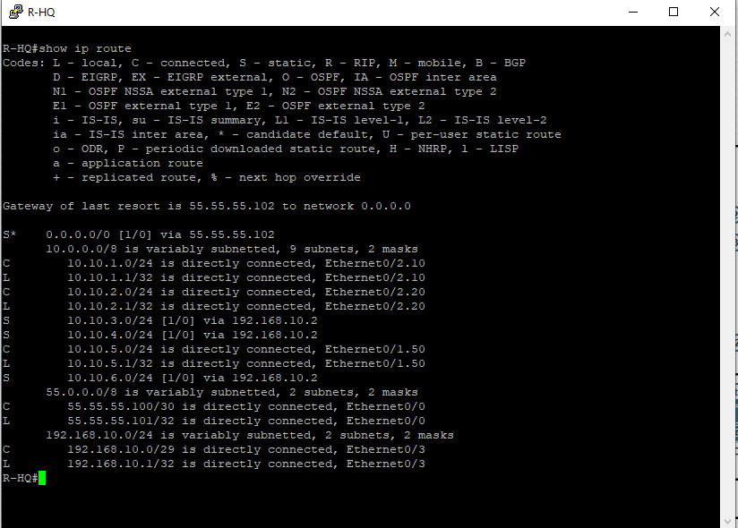
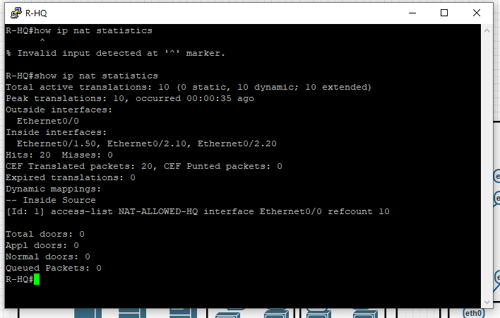
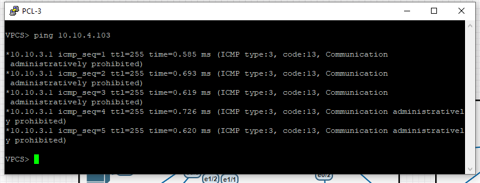
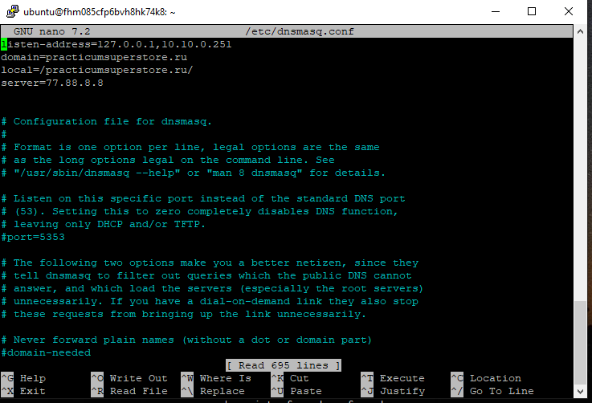
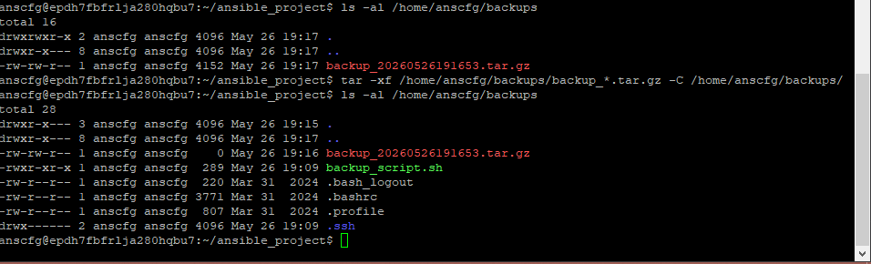
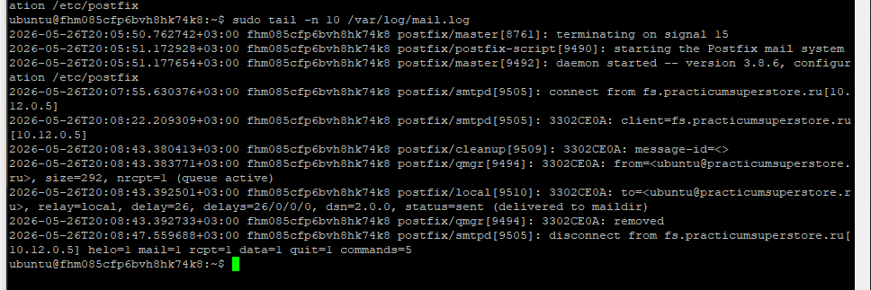
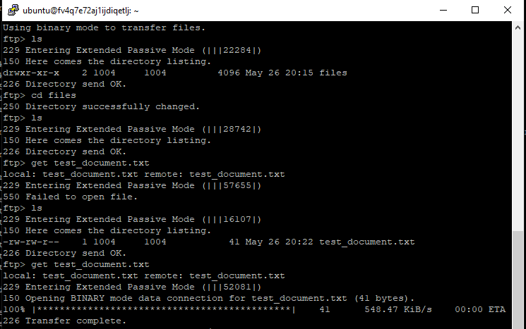
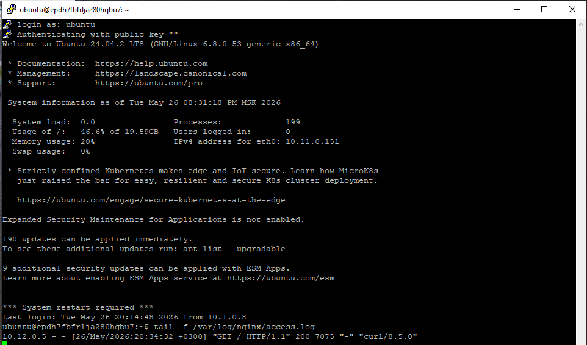
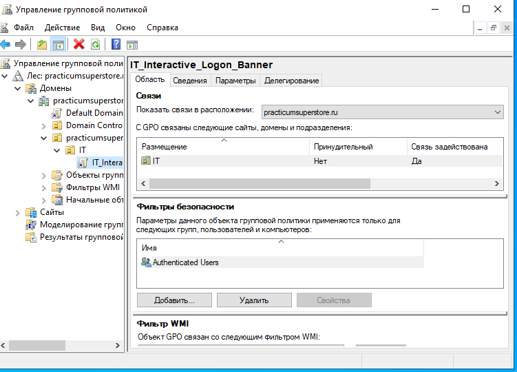
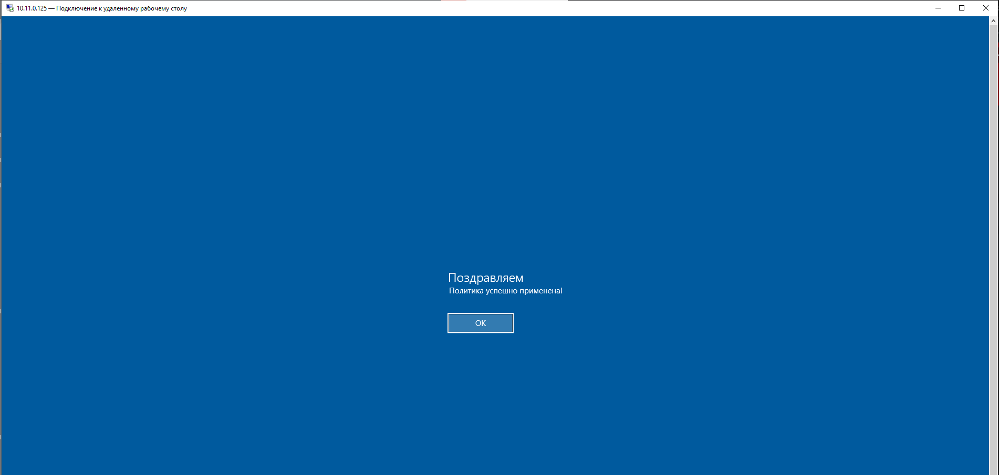

# Enterprise Network & Infrastructure Lab

Capstone project from Yandex Practicum's Information Security Engineer
program: a model of a retail company's IT infrastructure with a segmented
network, core Linux services and Active Directory. Everything was built
in a lab environment.

## Architecture

Two sites, a head office and a remote dark store, are connected through an
ISP router. Each site has its own router and switches. The head office has
IT and management user segments and a server segment (DC, DNS, Ansible,
Mail, Web, FS). The dark store has warehouse and logistics segments plus
Portal and FS servers.

## Part 1. Network design and configuration (EVE-NG, Cisco IOS)
- VLAN segmentation with 802.1Q trunks and router subinterfaces at both sites
- Static routing between the head office, the dark store and the ISP router
- Internet access through NAT overload (PAT) on the head office router
- Access control lists between segments (e.g. IT to Management, Logistics to Warehouse), verified by blocked pings

 
 
 

## Part 2. Core services on Linux (Ubuntu 24.04 virtual machines)
| Service | Implementation | Verified by |
|---|---|---|
| NTP | chrony | `chronyc tracking`, `timedatectl` |
| DNS | dnsmasq, internal zone `practicumsuperstore.ru` | `nslookup` from clients |
| Mail | Postfix, MX record in the internal DNS, Maildir | test message sent from another host and delivered, mail log |
| Ansible | managed server with a service account and a scheduled backup job | backup archive created, DNS and NTP checked on the managed server |
| File server | vsftpd with a chrooted local user | FTP download test |
| Web server | Nginx | test page with endpoint checks, access log |

 
 
 
 
 

## Part 3. Active Directory
- Domain `practicumsuperstore.ru` with an organizational unit `IT`, a domain user and a computer joined to the domain
- Group Policy `IT_Interactive_Logon_Banner` linked to the IT unit and verified by logging in over RDP

 
 

## What I would improve
- The FTP server runs without TLS; in production I would use SFTP or FTPS
- The Ansible service account has passwordless sudo, acceptable in a lab but too broad for production
- The web test page is served over plain HTTP; in production I would use HTTPS

## Tools
EVE-NG, Cisco IOS, Ubuntu 24.04, chrony, dnsmasq, Postfix, vsftpd, Nginx, Ansible, Windows Server (Active Directory, Group Policy)

Lab environment only. No real credentials or production data.
